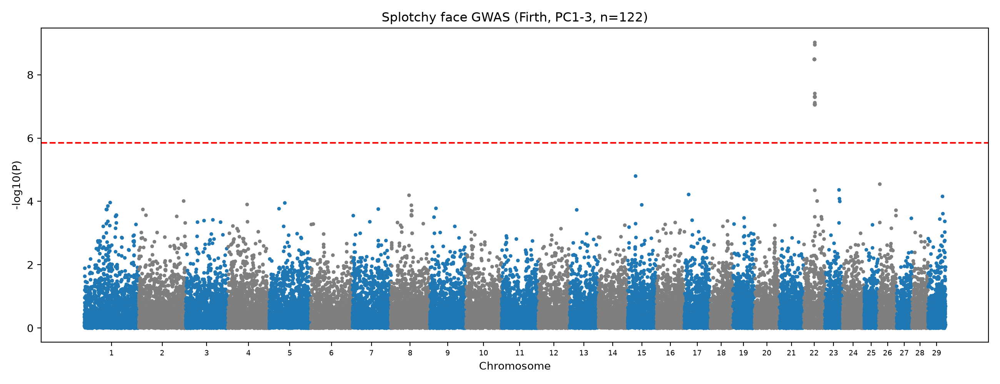

# Splotchy-face GWAS in cattle: a single locus at *MITF* on chromosome 22

An independent, fully scripted **reanalysis of a public dataset** (128 Hereford-cross calves, 41,534 SNPs) to
localise the genetic signal for the "splotchy face" coat phenotype and to test how robust it is in a very small,
partly related sample. The analysis uses PLINK 2 and Python; the written report is in [`report/`](report/).

> **Status:** reanalysis of data published by Jivanji *et al.* (2025). This repository is **not** affiliated with,
> or endorsed by, the authors of the source study. See [Relationship to the source study](#relationship-to-the-source-study).

## Main findings

| | |
|---|---|
| Animals / SNPs after QC | 124 animals and 35,048 autosomal SNPs; 122 animals (33 cases, 89 controls) after removing one animal genotyped twice with discordant phenotypes |
| Model | Firth logistic regression (additive), PLINK 2, adjusted for PC1–PC3 |
| Genome-wide significant SNPs | 37 (Bonferroni *P* < 1.43 × 10⁻⁶), **all on chr22: 31.57–32.42 Mb**, forming one LD clump |
| Lowest *P* | 9.4 × 10⁻¹⁰ at 22:31,655,675 |
| Candidate SNPs at *MITF* | 22:31,651,379 and 22:31,651,404, ~281 and ~306 bp upstream of the TSS of NM_001001150.2; in strong LD (r² = 0.93) and not separable in this sample |
| Genotype pattern | 91–94 % of cases but only 2–3 % of controls are heterozygous at these two SNPs |
| Genomic inflation | λ = 1.48 (1.46 excluding chr22); λ = 1.30 after removing relatives |
| Robustness | The same locus remains after duplicate removal, covariate adjustment, genomic control (13 SNPs) and removal of relatives (27 SNPs; lowest *P* = 2.1 × 10⁻⁷) |

Odds ratios from this sample reflect near-complete genotype separation and are **not** interpretable effect sizes.
All numbers above are recomputed from the PLINK output by [`scripts/verify_report_numbers.py`](scripts/verify_report_numbers.py)
(output: [`results/report_numbers.txt`](results/report_numbers.txt)).



## Repository layout

```
.
├── README.md  CITATION.cff  LICENSE  requirements.txt
├── report/        Splotchy_Face_GWAS_Analysis_Report.pdf   (full write-up)
├── scripts/
│   ├── run_pipeline.sh          end-to-end pipeline (PLINK 2 + Python)
│   ├── prepare_inputs.py        glue steps: unique variant IDs, phenotype coding, PC covariate file
│   ├── annotate_variants.py     strand-aware annotation against RefSeq (ARS-UCD1.2)
│   ├── manhattan_qq.py  chr22_plot.py  regional_plot.py     figures
│   └── verify_report_numbers.py recomputes the numbers quoted in the report
├── results/
│   ├── association/   primary Firth GWAS, relatives-removed GWAS, clump table, significant and annotated SNPs, VEP output
│   ├── qc/            eigenvalues/eigenvectors, KING relatedness lists, candidate-SNP genotypes
│   ├── plots/         Manhattan, QQ, chromosome 22 and regional plots
│   └── logs/          PLINK logs of the original run (local machine name and paths redacted)
├── data/
│   ├── raw/           NOT committed - download from Dryad (see data/raw/README.md)
│   ├── reference/     NOT committed - RefSeq GTF (see data/reference/README.md)
│   └── processed/     created by the pipeline
└── docs/              references.bib, acknowledgements and software citations
```

## Reproducing the analysis

1. **Requirements:** [PLINK 2](https://www.cog-genomics.org/plink/2.0/) (the original run used v2.0.0-a.7.12), Python 3 and
   `pip install -r requirements.txt`.
2. **Data:** download the four *splotchy* files from Dryad (<https://doi.org/10.5061/dryad.fxpnvx15q>) into `data/raw/`
   and place the RefSeq GTF in `data/reference/` as described in the two `README.md` files there. Checksums of the files
   used are listed in [`data/CHECKSUMS.sha256`](data/CHECKSUMS.sha256).
3. **Run:**
   ```bash
   bash scripts/run_pipeline.sh                 # primary analysis, figures, annotation
   RUN_SENSITIVITY=1 bash scripts/run_pipeline.sh   # also the logistic sensitivity analyses (report §3.3)
   ```
   Use `PLINK2=/path/to/plink2 bash scripts/run_pipeline.sh` if PLINK 2 is not on your `PATH`.

The glue scripts, annotation script and plots were checked to regenerate the stored outputs exactly (or visually, for
figures). The PLINK commands in `run_pipeline.sh` follow the options recorded in `results/logs/`.

## Methods in brief

* **QC:** `--mind 0.05 --geno 0.05 --maf 0.01`; unique variant IDs assigned (364 IDs were duplicated in the raw data).
* **Duplicate detection:** KING kinship flagged animals 15 and 23 as the same genotype (kinship 0.4996, IBS0 = 0) with
  discordant phenotypes; both were removed.
* **Structure and relatedness:** LD pruning (`--indep-pairwise 50 5 0.2`, 17,827 variants), PCA and a KING table.
* **Association:** `--glm firth`, covariates PC1–PC3, Bonferroni threshold 0.05 / 35,048.
* **Robustness:** genomic inflation (λ), genomic control, clumping (`--clump-p1 1.4266e-6 --clump-p2 0.001 --clump-r2 0.2 --clump-kb 1000`),
  an unrelated subset (KING cutoff 0.177), genotype-by-phenotype tables and a conditional analysis of the two lead SNPs.
* **Annotation:** transcript/exon records of the NCBI RefSeq GTF for ARS-UCD1.2 (release 2025-05-22) with signed distance
  to the nearest TSS, plus Ensembl VEP for the two lead SNPs.

## Limitations

Small sample (33 cases; 26 after removing relatives), residual genomic inflation (λ = 1.30 after removing relatives),
near-complete genotype separation, approximate genomic control, no independent replication, and no functional data in this
repository. A relatedness-aware mixed model (e.g. GCTA/REGENIE) is the most important next analysis. Details: report §6–7.

## Relationship to the source study

The genotypes and phenotypes were generated and released by Jivanji *et al.*, who analysed the same calves with a
mixed linear model, mapped the splotchy-face signal to the same *MITF* region, and proposed the intronic SNP
Chr22 g.31651379A>G as the likely causal variant on the basis of functional experiments (see the paper for details). This
repository does not add new data; it re-runs and stress-tests the association with a different statistical approach
and documents each step. Findings here should be read together with, not instead of, the original publication.

## How to cite

**This project** — GitHub's *"Cite this repository"* button (from [`CITATION.cff`](CITATION.cff)) gives APA and BibTeX. Manually:

Thaufiq, M. (2026). Splotchy-face GWAS in cattle: reanalysis of public data identifies a single locus at MITF (Version 1.0.0) [Computer software]. https://github.com/Thaufiq2004/cattle-splotchy-face-gwas

```bibtex
@software{Thaufiq_Splotchy-face_GWAS_in_2026,
author = {Thaufiq, Md.},
license = {MIT},
month = nov,
title = {{Splotchy-face GWAS in cattle: reanalysis of public data identifies a single locus at MITF}},
url = {https://github.com/Thaufiq2004/cattle-splotchy-face-gwas},
version = {1.0.0},
year = {2026}
}
```

**Please also cite the original study and dataset** whenever you use these data or results:

> Jivanji, S., Wilkinson, E., Tang, L., Tiplady, K. M., Yeates, A., Harland, C., Gray, C., Couldrey, C., Worth, G.,
> Gamache, I., Desjardins, J., Tabares, J. A. A., Yamanaka, N., McNaughton, L., Brennan, L., Cloutier, M.-P., Cowan, M.,
> Ellison, R., Fransen, T., Monehan, T., Spelman, R. J., Snell, R. G., Charlier, C., Yamanaka, Y., Garrick, D., Mort, R.,
> & Littlejohn, M. D. (2025). Structural and epistatic regulatory variants cause hallmark white spotting in cattle.
> *Science Advances, 11*(46), eadt5913. https://doi.org/10.1126/sciadv.adt5913
>
> Dataset: Dryad, https://doi.org/10.5061/dryad.fxpnvx15q

Citations for PLINK 2, KING, Firth regression, genomic control, ARS-UCD1.2, RefSeq, Ensembl VEP and the Python
libraries are in [`docs/ACKNOWLEDGEMENTS_AND_CITATIONS.md`](docs/ACKNOWLEDGEMENTS_AND_CITATIONS.md) and
[`docs/references.bib`](docs/references.bib).

## License

Code: MIT (see [`LICENSE`](LICENSE)). The report and figures are shared under CC BY 4.0. The input data remain
under the terms set by their Dryad record and are not redistributed here.

## Contact

Md. Thaufiq — open an [issue](../../issues) for questions or corrections.
